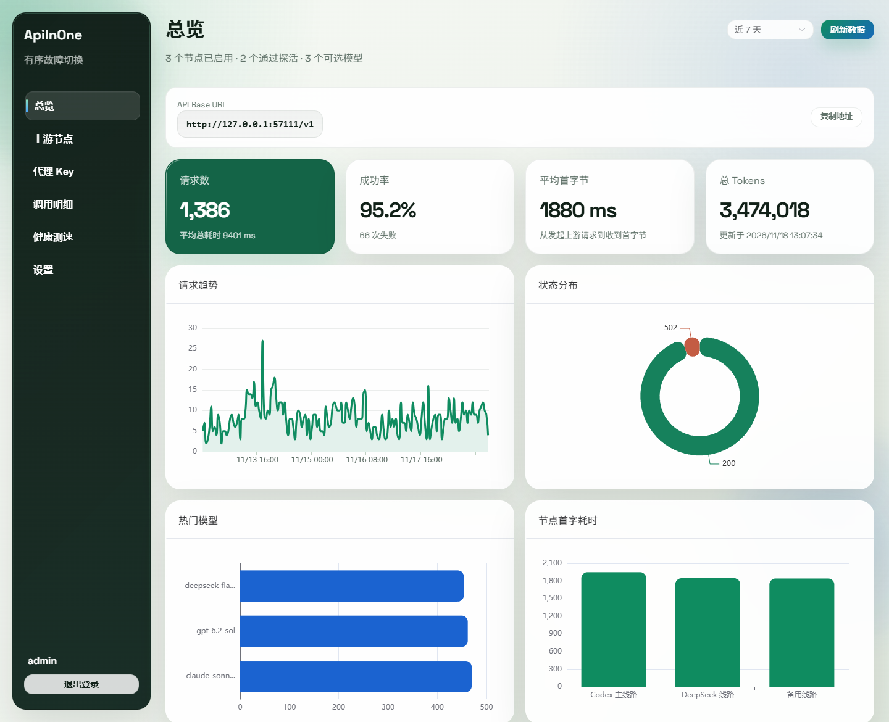
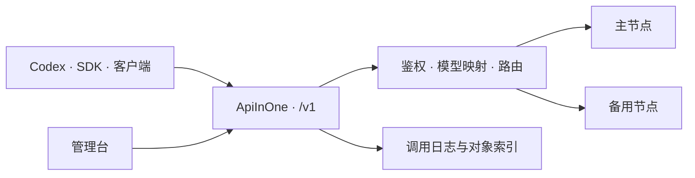

# ApiInOne

**给 Codex 和 OpenAI 兼容客户端一个统一的 API 地址。**

把多个上游的模型、密钥和优先级集中在一台机器上管理。客户端通过独立代理 Key 调用，节点变更和故障切换由中转站处理。管理台可以直接查看模型探查、流式探活、调用明细和 Token 用量。

[快速开始](#快速开始) · [Codex 接入](#codex-接入) · [路由与故障切换](#路由与故障切换) · [部署与运维](#部署与运维)



*管理台总览，使用示例数据。*

## 能做什么

| 场景 | 功能 |
| --- | --- |
| 一个客户端调用多个节点 | 按模型和接口能力路由，支持模型名映射 |
| 处理节点波动 | 有序故障切换、延迟优选、超时节点恢复探测 |
| 给不同设备分发访问权限 | 独立代理 Key，可在后台停用并查看最后使用时间 |
| 定位调用错误 | 按模型、节点、Key、日期和状态筛选日志，查看 Token、首字节和流中断原因 |
| 自托管 | 单进程 WSGI 服务，本地 SQLite 和 YAML 持久化 |

支持 OpenAI 风格的 Chat Completions、Responses、SSE、文件上传与下载。目标上游需要实现对应接口能力。 [Codex 配置参考](https://learn.chatgpt.com/docs/config-file/config-reference)

## 快速开始

使用 Python 3.10 及以上版本。

```bash
git clone https://github.com/bianyh/ApiInOne.git
cd ApiInOne
python3 -m venv .venv
source .venv/bin/activate
python -m pip install -r requirements.txt

export RELAY_ADMIN_PASSWORD='换成自己的管理员密码'
export RELAY_ADMIN_SECRET_KEY="$(python -c 'import secrets; print(secrets.token_hex(32))')"
RELAY_BIND=127.0.0.1 python app.py
```

<details>
<summary>Windows PowerShell</summary>

```powershell
git clone https://github.com/bianyh/ApiInOne.git
Set-Location ApiInOne
python -m venv .venv
.\.venv\Scripts\python.exe -m pip install -r requirements.txt

$env:RELAY_ADMIN_PASSWORD = "换成自己的管理员密码"
$env:RELAY_ADMIN_SECRET_KEY = (.\.venv\Scripts\python.exe -c "import secrets; print(secrets.token_hex(32))")
$env:RELAY_BIND = "127.0.0.1"
.\.venv\Scripts\python.exe app.py
```

</details>

1. 打开 [管理台](http://127.0.0.1:8000/admin/)，使用默认用户名 `admin` 和刚设置的密码登录。
2. 在 **上游节点** 中填写 Base URL 和 API Key。探查模型或手动填写模型名，再选择相应的接口能力。
3. 在 **代理 Key** 中生成一个客户端密钥。将总览里的 API 地址与该 Key 填入客户端。

可以用下面的请求检查代理 Key 和模型列表。

```bash
curl -fsS http://127.0.0.1:8000/v1/models \
  -H "Authorization: Bearer $RELAY_API_KEY"
```

`RELAY_API_KEY` 是管理台生成的代理 Key。可在 [config.example.yaml](config.example.yaml) 中查看服务器配置格式。

## Codex 接入

在 `~/.codex/config.toml` 中设置自定义供应商。用你的上游实际支持的模型名替换示例，并把代理 Key 放进客户端环境变量 `RELAY_API_KEY`。

```toml
model = "gpt-6.2-sol"
model_provider = "apiinone"

[model_providers.apiinone]
name = "ApiInOne"
base_url = "http://127.0.0.1:8000/v1"
env_key = "RELAY_API_KEY"
wire_api = "responses"
supports_websockets = false
```

Codex 会通过 `POST /v1/responses` 建立流式连接。可在后台用相同的模型名和探活接口验证节点。只提供 Chat Completions 的网关需要支持 Responses 的适配层。 [Codex 配置参考](https://learn.chatgpt.com/docs/config-file/config-reference)

## 路由与故障切换



- **有序故障切换**按节点顺序尝试。**延迟优选**在符合模型及接口能力的节点中，优先使用健康状态和首字节延迟更好的节点。
- 开启自动切换时，上游连接异常或返回 HTTP 408、429、5xx，可在向客户端发送响应前尝试下一个候选节点。
- 超时节点定期接受恢复探测。恢复后，节点按配置的路由策略重新参与调度。
- 带对象 ID 的请求会发往创建该对象的上游。文件、Response 等对象的归属通过 SQLite 保存。
- 大响应分块发送，JSON 和 SSE 中的对象归属与用量仍会记录。文件下载会转发上游支持的 Range 请求。

## 部署与运维

`python app.py` 使用 Waitress。默认监听 `0.0.0.0:8000`，以 6 个线程处理请求，单请求体上限为 32 MiB。 [Waitress 参数说明](https://docs.pylonsproject.org/projects/waitress/en/stable/arguments.html)

| 环境变量 | 用途 |
| --- | --- |
| `RELAY_BIND` / `RELAY_PORT` | 监听地址和端口 |
| `RELAY_THREADS` | 请求线程数，长流会占用线程 |
| `RELAY_MAX_BODY_MB` | 请求体上限，单位 MiB |
| `RELAY_ADMIN_USERNAME` / `RELAY_ADMIN_PASSWORD` | 管理台登录账号 |
| `RELAY_ADMIN_SECRET_KEY` | 会话签名密钥，服务重启时应使用同一值 |
| `RELAY_COOKIE_SECURE=1` | 使用 HTTPS 部署时启用安全会话 Cookie |

### Linux 常驻

- **tmux** 中执行 `bash deploy/run-relay.sh`。脚本在进程异常退出后延迟 5 秒重启。可用 `RELAY_PYTHON` 指定虚拟环境的 Python。
- **systemd** 可使用 [示例 service](deploy/systemd/openai-relay.service)。按实际路径修改用户、工作目录和启动命令，将环境变量放入仅管理员可读的配置文件。

`GET /healthz` 返回进程存活状态。模型能否调用，以管理台的模型探活为准。公网部署可在中转站前配置 HTTPS 反向代理。

### 数据和备份

| 文件 | 内容 |
| --- | --- |
| `config.yaml` | 上游与代理 Key 配置、模型映射、探活策略 |
| `data/requests.sqlite3` | 调用日志、分页和报表的数据源 |
| `data/object-index.sqlite3` | 对象 ID 与上游的对应关系 |
| `data/health.json` | 主动探活和被动健康记录 |

首次启动时会导入旧版 `requests-*.jsonl` 和 `object-index.json` 中的有效记录。旧文件可用作备份。运行中的 SQLite 数据可用备份 API 导出，或在停机后连同配置目录一起复制。运行时数据已列入 `.gitignore`。

遇到 `Killed` 时，可在 Linux 用 `journalctl -k --grep='Out of memory|Killed process'` 核对是否发生 OOM。看到 `413` 时，可根据上游和服务器内存调整请求体限制。

## 开发

```bash
python -m pytest -q
```

后端位于 [relay/](relay/)，管理台由 Flask 渲染模板，通过浏览器加载 Vue、Element Plus 和 ECharts。
